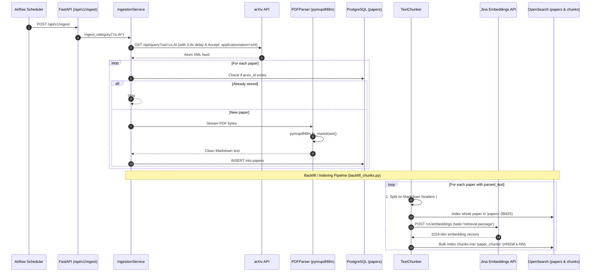

# Agentic RAG Curator

<div align="center">
  <h3>A Production-Style Hybrid RAG System over arXiv ML Papers</h3>
  <p><strong>Hybrid Search (BM25 + k-NN) • Reciprocal Rank Fusion • Grounded Citations • Multi-Provider Fallback • SSE Streaming • Airflow 3.0 Ingestion • Gradio UI</strong></p>
</div>

<p align="center">
  
  
  
  
  
  
  
  
</p>

---

## Table of Contents

- [About the Project](#about-the-project)
- [System Architecture & Docker Network](#system-architecture--docker-network)
- [Database & Storage Schemas](#database--storage-schemas)
- [How Ingestion Works](#how-ingestion-works)
- [How the RAG Engine Works](#how-the-rag-engine-works)
  - [1. Dual Retrieval & Deduplication](#1-dual-retrieval--deduplication)
  - [2. Reciprocal Rank Fusion (RRF)](#2-reciprocal-rank-fusion-rrf)
  - [3. The "Abstract + Excerpt" Context Assembly](#3-the-abstract--excerpt-context-assembly)
  - [4. Grounded Prompting & Hard Refusal](#4-grounded-prompting--hard-refusal)
  - [5. Resilient Multi-Provider LLM Client with Fallback](#5-resilient-multi-provider-llm-client-with-fallback)
  - [6. Deterministic Server-Side Citation Extraction](#6-deterministic-server-side-citation-extraction)
  - [7. Real-Time SSE Streaming](#7-real-time-sse-streaming)
- [Interfaces & Interactive UI](#interfaces--interactive-ui)
- [Engineering Decisions, Tradeoffs & Post-Mortem](#engineering-decisions-tradeoffs--post-mortem)
- [Quick Start Guide](#quick-start-guide)
- [API Endpoints Reference](#api-endpoints-reference)
- [Environment Variables Configuration](#environment-variables-configuration)
- [Evaluation & Benchmarking](#evaluation--benchmarking)

---

## About the Project

**Agentic RAG Curator** fetches recent scientific research papers from the arXiv API, parses their full contents into structured Markdown, and indexes them into both keyword and vector search engines. It answers complex technical research questions **grounded strictly in the retrieved paper text**, providing deterministic, clickable citations mapped to original sources.

### Core Philosophy
1. **Search Foundations First**: High-quality retrieval precedes all LLM generation. BM25 keyword matching catches exact technical acronyms and named entities; dense k-NN vector search catches semantic paraphrasing.
2. **Never Trust Model-Generated Citations**: Models hallucinate or truncate long paper IDs. The server numbers context blocks (`[1]`, `[2]`), instructs the model to cite only bracketed numbers, and resolves the real metadata deterministically on the server.
3. **No Guessing / Hard Refusals**: If the retrieved papers do not contain the answer, the model outputs a strict refusal string, suppressing any citation leakage.
4. **Decoupled Orchestration**: Application logic and orchestrators (Airflow) are completely isolated over HTTP boundaries to eliminate cross-dependency corruption.

---

## System Architecture & Docker Network

The entire ecosystem runs containerized on an isolated Docker bridge network:

```mermaid
flowchart TB
    subgraph Host["Host Machine"]
        User["User / Web Browser"]
        GradioApp["Gradio Web UI (:7861)\n(grad.py)"]
        AirflowUI["Airflow UI (:8080)"]
    end

    subgraph DockerNet["Docker Network (Bridge)"]
        subgraph AppStack["Core RAG Application Stack"]
            FastAPI["FastAPI App (rag-app)\nInternal: :8000 | Host: :8001\nRoutes: /ask, /search, /ingest"]
            PG[("PostgreSQL 16 (rag-postgres)\nInternal: :5432 | Host: :5433\nDB: rag_curator (papers metadata + text)")]
            OS[("OpenSearch 2.18 (rag-opensearch)\nInternal: :9200 | Host: :9200\nIndices: papers, paper_chunks")]
            Redis[("Redis 7 (rag-redis)\nInternal: :6379 | Host: :6379\nCache: ask query answers")]
        end

        subgraph AirflowStack["Airflow 3.0 Orchestration Stack"]
            AF_PG[("PostgreSQL 16 (airflow-postgres)\nInternal: :5432\nDB: airflow metadata")]
            AF_Init["airflow-init\n(airflow db migrate)"]
            AF_Web["airflow-webserver (:8080)\nCommand: api-server"]
            AF_Sched["airflow-scheduler\nCommand: scheduler"]
            AF_DAG["airflow-dag-processor\nCommand: dag-processor"]
        end

        AF_Sched -.->|"HTTP POST /api/v1/ingest"| FastAPI
        FastAPI -->|"SQLAlchemy / psycopg2"| PG
        FastAPI -->|"opensearch-py (HTTP)"| OS
        FastAPI -->|"redis.asyncio"| Redis
        AF_Init --> AF_PG
        AF_Web --> AF_PG
        AF_Sched --> AF_PG
        AF_DAG --> AF_PG
        AF_Sched -->|"JWT Auth :8080/execution/"| AF_Web
    end

    subgraph CloudAPIs["External SaaS / Cloud APIs"]
        ArXiv["arXiv Atom API\n(export.arxiv.org)"]
        Jina["Jina AI Embeddings\n(api.jina.ai/v1/embeddings)"]
        Gemini["Google Gemini\n(generativelanguage.googleapis.com)"]
        Groq["Groq Cloud\n(api.groq.com/openai/v1)"]
        Langfuse["Langfuse Cloud / Tracing\n(cloud.langfuse.com)"]
    end

    FastAPI -->|"HTTPS GET"| ArXiv
    FastAPI -->|"HTTPS POST (1024-dim)"| Jina
    FastAPI -->|"HTTPS POST (Primary LLM)"| Gemini
    FastAPI -.->|"HTTPS POST (Fallback LLM)"| Groq
    FastAPI -->|"Async Tracing Spans"| Langfuse
    User -->|"HTTP :8001"| FastAPI
    User -->|"HTTP :7861"| GradioApp
    GradioApp -->|"HTTP POST /api/v1/ask"| FastAPI
    AirflowUI -->|"HTTP :8080"| AF_Web
```



### Port Mapping & Container Resolution
| Service | Internal Port | Host Port | Role |
|---|---|---|---|
| `app` | `8000` | `8001` | FastAPI core REST API & SSE streaming |
| `postgres` | `5432` | `5433` | Application database (avoids local port 5432 conflicts) |
| `opensearch`| `9200` | `9200` | BM25 search & k-NN vector search engine |
| `redis` | `6379` | `6379` | Query-response cache with TTL |
| `airflow-webserver` | `8080` | `8080` | Airflow 3.0 execution API server & UI |
| `gradio` | - | `7861` | Interactive desktop/browser chat application |

---

## Database & Storage Schemas

### 1. PostgreSQL (`papers` Table)
Managed via SQLAlchemy 2.0 (`src/models/paper.py`) and Alembic migrations:
- **`id`** (`INTEGER`, PK): Autoincrementing primary key.
- **`arxiv_id`** (`VARCHAR(50)`, Indexed, Unique): Canonical paper ID (e.g., `2609.20822v1`).
- **`title`** (`TEXT`, Not Null): Cleaned paper title.
- **`abstract`** (`TEXT`, Not Null): Paper summary abstract.
- **`authors`** (`TEXT`, Not Null): Comma-separated list of author names.
- **`categories`** (`VARCHAR(200)`, Not Null): Subject categories (e.g., `cs.AI, cs.LG, cs.CL`).
- **`pdf_url`** (`TEXT`, Not Null): Direct PDF URL.
- **`parsed_text`** (`TEXT`, Nullable): Clean Markdown extracted from PDF by `pymupdf4llm`.
- **`published_at`** (`TIMESTAMPTZ`, Not Null): Original submission date.
- **`ingested_at`** (`TIMESTAMPTZ`): Record insertion timestamp.

### 2. OpenSearch Dual-Index Architecture
Defined in `src/services/opensearch/index_setup.py`:

#### A. `papers` Index (Keyword / BM25 Search)
Used for whole-document keyword ranking and metadata retrieval:
- `arxiv_id`: `keyword`
- `title`: `text` (query boosted $\times 3$)
- `abstract`: `text` (query boosted $\times 2$)
- `parsed_text`: `text` (query unboosted)
- `categories`: `keyword`
- `published_at`: `date`

#### B. `paper_chunks` Index (Dense Vector / k-NN Search)
Stores segmented document sections for granular semantic retrieval:
- **Document ID**: `{arxiv_id}_{chunk_index}` (idempotent re-indexing).
- `arxiv_id`: `keyword`
- `chunk_index`: `integer`
- `section_title`: `keyword` (nearest Markdown header)
- `text`: `text`
- `categories`: `keyword`
- `embedding`: `knn_vector`
  - Dimensions: `1024` (matches Jina v3)
  - Method: `hnsw`
  - Space Type: `cosinesimil`
  - Engine: `nmslib`

### 3. Redis Cache
Configured in `src/services/cache.py`:
- **Key Pattern**: `ask:v1:{sha256(q:<normalized_question>|n:<papers>|c:<category>)}`
- **TTL**: 86,400s (24 hours).
- **Graceful Degradation**: If Redis is offline, calls are wrapped in non-blocking handlers treating it as a cache miss.

---

## How Ingestion Works



### Ingestion Pipeline Highlights:
1. **Polite API Crawler**: Enforces a 3.0-second delay between queries to respect arXiv’s terms of service and sets `Accept: application/atom+xml`.
2. **Structure-Preserving PDF Parsing**: Uses `pymupdf4llm` to preserve tables, section headers, bold text, and math equations as clean Markdown.
3. **Two-Stage Chunking**:
   - **Stage 1 (Semantic Splitting)**: `MarkdownHeaderTextSplitter` splits on `#`, `##`, and `###` tags to preserve section titles.
   - **Stage 2 (Size Control)**: `RecursiveCharacterTextSplitter` chunks long sections into 1000-character segments with 150-character overlap.
4. **Idempotent Resumable Backfill**: `scripts/backfill_chunks.py` checks existing chunk IDs via OpenSearch aggregation, processing only unindexed papers without duplicating existing vectors.

---

## How the RAG Engine Works

```mermaid
flowchart TD
    UserQuery(["User Query: 'What is RAFT?'\nPOST /api/v1/ask"]) --> CacheCheck{"Check Redis Cache\nKey: ask:v1:hash"}
    
    CacheCheck -- "Cache Hit" --> ReturnCached["Return Cached JSON Answer"]
    CacheCheck -- "Cache Miss" --> ParallelSearch["Initiate Dual Retrieval"]

    subgraph DualRetrieval["Hybrid Retrieval (hybrid.py)"]
        direction TB
        subgraph BM25Search["BM25 Keyword Search"]
            Q1["Query: 'What is RAFT?'"] --> BM25Query["multi_match on 'papers'\ntitle^3, abstract^2, parsed_text\nCandidate pool = 50"]
            BM25Query --> BM25Hits["Ranked List 1: [Paper A, Paper B, ...]"]
        end

        subgraph VectorSearch["k-NN Dense Vector Search"]
            Q2["Query: 'What is RAFT?'"] --> JinaQuery["Jina Embeddings API\ntask='retrieval.query'\n1024 dimensions"]
            JinaQuery --> KNNQuery["k-NN Query on 'paper_chunks'\nspace_type: cosinesimil\nCandidate pool = 50"]
            KNNQuery --> VectorHits["Ranked List 2: [Chunk A1, Chunk B2, ...]"]
        end
    end

    ParallelSearch --> BM25Search
    ParallelSearch --> VectorSearch

    BM25Hits --> Dedupe1["Deduplicate Paper IDs"]
    VectorHits --> Dedupe2["Deduplicate Paper IDs\n(Record Best Chunk per Paper)"]

    Dedupe1 --> RRF["Reciprocal Rank Fusion (k=60)\nScore = Σ 1 / (60 + rank)"]
    Dedupe2 --> RRF

    RRF --> TopN["Select Top N Papers (Default: 5)"]

    TopN --> ContextAssembly["Context Assembly (mget)\nCombine Abstract + Best Excerpt per paper:\n[1] Title: ...\nAbstract: ...\nExcerpt: ...\n[2] Title: ..."]

    ContextAssembly --> GroundedPrompt["Grounded Prompt Construction\n(System instructions: cite inline [n],\nnever use outside knowledge,\nfixed refusal if missing)"]

    subgraph LLMExecution["LLM Client with Fallback (client.py)"]
        direction TB
        TryGemini["1. Try Gemini (gemini-flash-latest)\nTimeout: 60s, Retries: 3"]
        TryGemini -- "429 / 5xx Overload" --> FallbackGroq["2. Fallback to Groq (llama-3.3-70b-versatile)"]
        FallbackGroq -- "Success" --> LLMResponse["Raw Assistant Response"]
        TryGemini -- "Success" --> LLMResponse
    end

    GroundedPrompt --> LLMExecution

    LLMResponse --> CitationExtraction["Server-side Citation Mapping (rag.py)\nExtract [1], [2], 【1】 via Regex\nResolve to exact paper metadata\nIf answer is refusal -> Empty sources"]

    CitationExtraction --> CacheStore["Store in Redis (TTL: 24h)\n(Skip caching if refusal)"]
    CacheStore --> FinalResponse(["Return Final JSON / Stream SSE\n{answer: '...', sources: [{arxiv_id, title}]}"]
```

### 1. Dual Retrieval & Deduplication
Every query fires two parallel searches with a candidate pool size of 50:
- **BM25 Search**: Matches text keywords against `title^3`, `abstract^2`, and `parsed_text`.
- **Dense k-NN Search**: The query is converted into an embedding using Jina with `task="retrieval.query"` and matched against chunk vectors using cosine similarity.
- **Paper-Level Deduplication**: Multiple chunk matches from the same paper in vector search are consolidated, recording the highest-scoring chunk as that paper's best representative.

### 2. Reciprocal Rank Fusion (RRF)
BM25 and vector similarity scores cannot be reliably combined using weighted sums due to scale mismatch. We apply Reciprocal Rank Fusion ($k = 60$):
$$\text{RRF}(d) = \sum_{m \in \{\text{BM25}, \text{Vector}\}} \frac{1}{60 + \text{rank}_m(d)}$$

### 3. The "Abstract + Excerpt" Context Assembly
Sending only an isolated chunk often misses global acronym expansions and definitions found in the abstract. Sending the entire paper wastes tokens. We execute an OpenSearch `mget` across the top $N$ papers to build a structured context block for each paper:
```text
[1] Title: Self-RAG: Learning to Retrieve, Generate, and Critique through Self-Reflection
Abstract: Large language models often hallucinate... We introduce Self-RAG...

Excerpt: ...During training, the critic model evaluates retrieved passages...
```

### 4. Grounded Prompting & Hard Refusal
The system prompt strictly restrains the LLM:
- Answer **ONLY** using the provided numbered context.
- Never use outside knowledge or extrapolate definitions.
- Cite sources inline using bracketed context numbers: `[1]`, `[2]`.
- If the answer cannot be explicitly found, return verbatim: `"I could not find this in the retrieved papers."`

### 5. Resilient Multi-Provider LLM Client with Fallback
The client in `src/services/llm/client.py` uses an OpenAI-compatible interface:
1. **Primary**: Google Gemini (`gemini-flash-latest`) via its OpenAI endpoint.
2. **Retries**: Up to 3 attempts with exponential backoff on retryable HTTP errors (`429`, `500`, `502`, `503`, `504`).
3. **Fallback**: If Gemini fails or hits quota limits, execution seamlessly transfers to Groq (`llama-3.3-70b-versatile`).

### 6. Deterministic Server-Side Citation Extraction
Rather than relying on LLMs to accurately reproduce complex arXiv IDs, the server parses citation tokens using regex:
```python
nums = {
    int(n)
    for group in re.findall(r"[\[【]([\d,\s]+)[\]】]", answer)
    for n in re.findall(r"\d+", group)
}
```
*(Supports standard `[1]` brackets and full-width `【1】` tokens produced by some multilingual models).*
The server maps those indices directly back to verified context papers. If the response is a refusal, `sources` is cleared.

### 7. Real-Time SSE Streaming
`POST /api/v1/ask/stream` streams responses token by token via Server-Sent Events:
```http
HTTP/1.1 200 OK
Content-Type: text/event-stream

data: {"type": "token", "text": "RAFT"}
data: {"type": "token", "text": " stands for Retrieval Augmented..."}
data: {"type": "sources", "sources": [{"arxiv_id": "2609.20822v1", "title": "..."}]}
data: [DONE]
```

---

## Interfaces & Interactive UI

### 1. Gradio Web Interface (`grad.py`)
A clean interactive UI built with Gradio:
- Launch locally on port `7861`:
  ```bash
  python grad.py
  ```
- Submits queries directly to the FastAPI `/api/v1/ask` endpoint and renders Markdown answers with clickable arXiv source links.

### 2. FastAPI Interactive Swagger Docs
- Navigate to `http://localhost:8001/docs` to test BM25 search, hybrid search, ingestion triggers, and streaming endpoints interactively.

---

## Engineering Decisions, Tradeoffs & Post-Mortem

| Problem / Symptom | Root Cause | Architectural Fix / Resolution |
|---|---|---|
| **Airflow 3.0 runtime corruption** | Installing app requirements into the Airflow container forced `sqlalchemy>=2.0`, breaking Airflow's internal core (`sqlalchemy<2.0`). | **Decoupled over HTTP**: Airflow runs isolated and triggers `/api/v1/ingest` via HTTP requests. |
| **Airflow DAGs missing ("0 DAGs found")** | In Airflow 3.0, DAG parsing was moved out of the scheduler into a separate `dag-processor` service. | Added a dedicated `airflow-dag-processor` container in `compose.yml`. |
| **`HTTP 403 Signature verification failed` in Airflow** | Airflow webserver and scheduler auto-generated different JWT signing secrets on boot. | Configured a fixed shared secret across all Airflow containers via `AIRFLOW__API_AUTH__JWT_SECRET`. |
| **arXiv API returned `406 Not Acceptable`** | `httpx` default headers were rejected by arXiv's edge servers when called from Docker containers. | Added explicit `Accept: application/atom+xml` and custom `User-Agent` headers. |
| **Ollama local image pulls took hours** | Local 3.8 GB images repeatedly timed out over consumer network connections. | Migrated to hosted Gemini and Groq APIs using an OpenAI-compatible client interface. |
| **Thin context caused false refusals** | Vector retrieval returned only a passing mention chunk, missing the paper's primary definition. | Implemented the **"Abstract + Excerpt"** strategy, combining whole-paper abstract with the best section chunk. |
| **Fallback model hallucinated acronyms** | A small 7B fallback model failed to follow negative constraints and invented citations. | Enforced a minimum capability floor using `llama-3.3-70b-versatile` on Groq. |
| **LLMs mangled arXiv citations** | Asking models to copy identifiers like `2609.20754v1` led to transpositions (e.g. `[2609.2076]`). | Switched to numbered context blocks (`[1]`, `[2]`), resolving paper metadata deterministically on the server. |
| **Streaming fallback conflict** | Mid-stream provider failover after tokens have already been emitted would send duplicated text. | Once `yielded == True` in SSE streaming, provider fallback is aborted and an error event is emitted instead. |
| **Multi-chunk skew in RRF ranking** | A single paper with multiple chunk hits consumed all top positions in rank fusion. | Added `dedupe_ids()` prior to rank fusion to retain only the single best-ranked chunk per paper. |

---

## Quick Start Guide

### Prerequisites
- [Docker Desktop](https://www.docker.com/products/docker-desktop/) (with Docker Compose)
- Python 3.12+ (for local development or Gradio UI)
- API Keys:
  - [Jina AI Key](https://jina.ai/embeddings/) (Free tier available)
  - [Google Gemini API Key](https://aistudio.google.com/)
  - [Groq API Key](https://console.groq.com/) (Optional fallback)

### 1. Clone & Configure
```bash
git clone https://github.com/PG219/agentic-rag-curator.git
cd agentic-rag-curator

cp .env.example .env
# Edit .env and supply your JINA_API_KEY, LLM_API_KEY, and GROQ_API_KEY
```

### 2. Boot Services via Docker Compose
```bash
docker compose up --build -d
```
Check container status:
```bash
docker compose ps
```

### 3. Run Migrations & Indexing
```bash
# Run database migrations
alembic upgrade head

# Backfill chunk vectors for ingested papers
python scripts/backfill_chunks.py
```

### 4. Run the Gradio Chat UI
```bash
python -m venv .venv
.venv\Scripts\activate       # Windows PowerShell
# source .venv/bin/activate   # Linux/macOS

pip install gradio httpx
python grad.py
```
Open [http://localhost:7861](http://localhost:7861) in your browser.

---

## API Endpoints Reference

### 1. Ask a Question (JSON Response)
```bash
curl -X POST "http://localhost:8001/api/v1/ask?q=What+is+RAFT&n=5"
```
**Sample Response**:
```json
{
  "question": "What is RAFT",
  "answer": "RAFT (Retrieval-Augmented Fine-Tuning) is a training recipe that adapts language models for domain-specific RAG... [1].",
  "sources": [
    {
      "arxiv_id": "2609.20822v1",
      "title": "RAFT: Adapting Language Model to Domain Specific RAG"
    }
  ]
}
```

### 2. Stream an Answer (Server-Sent Events)
```bash
curl -N -X POST "http://localhost:8001/api/v1/ask/stream?q=What+is+RAFT"
```

### 3. Hybrid Search
```bash
curl -X POST "http://localhost:8001/api/v1/hybrid-search?q=speculative+decoding"
```

### 4. Trigger Ingestion
```bash
curl -X POST "http://localhost:8001/api/v1/ingest"
```

---

## Environment Variables Configuration

| Variable | Default Value | Description |
|---|---|---|
| `POSTGRES_USER` | `postgres` | PostgreSQL username |
| `POSTGRES_PASSWORD` | `postgres` | PostgreSQL password |
| `POSTGRES_DB` | `rag_curator` | Application database name |
| `POSTGRES_PORT` | `5433` | Host port mapped to container 5432 |
| `OPENSEARCH_PORT` | `9200` | OpenSearch HTTP port |
| `REDIS_PORT` | `6379` | Redis cache port |
| `REDIS_TTL_SECONDS` | `86400` | Answer cache expiration (24h) |
| `JINA_API_KEY` | - | Jina AI key for `jina-embeddings-v3` |
| `LLM_BASE_URL` | `https://generativelanguage.googleapis.com/v1beta/openai/` | OpenAI-compatible endpoint |
| `LLM_API_KEY` | - | Primary Gemini API key |
| `LLM_MODEL` | `gemini-flash-latest` | Primary model name |
| `GROQ_BASE_URL` | `https://api.groq.com/openai/v1` | Fallback LLM endpoint |
| `GROQ_API_KEY` | - | Groq Cloud API key |
| `GROQ_MODEL` | `llama-3.3-70b-versatile` | Fallback model name |
| `LANGFUSE_PUBLIC_KEY`| - | Langfuse public tracing key |
| `LANGFUSE_SECRET_KEY`| - | Langfuse secret key |

---

## Evaluation & Benchmarking

The evaluation harness in `eval.py` benchmarks 15 queries combining keyword-heavy and semantic paraphrases across Precision@5, Recall@10, and Mean Reciprocal Rank (MRR):

```bash
python eval.py
```

### Retrieval Comparison Summary
| Metric | BM25 Alone | Vector Search Alone | Hybrid Search (RRF) |
|---|---|---|---|
| **Precision@5** | 0.320 | 0.307 | **0.333** |
| **Recall@10** | 0.440 | 0.413 | **0.480** |
| **Reciprocal Rank** | 0.612 | 0.589 | **0.675** |

*Hybrid search outperforms single-retriever strategies across all metrics by combining lexical precision with dense semantic recall.*

---

## License

Distributed under the MIT License. See [LICENSE](LICENSE) for details.
